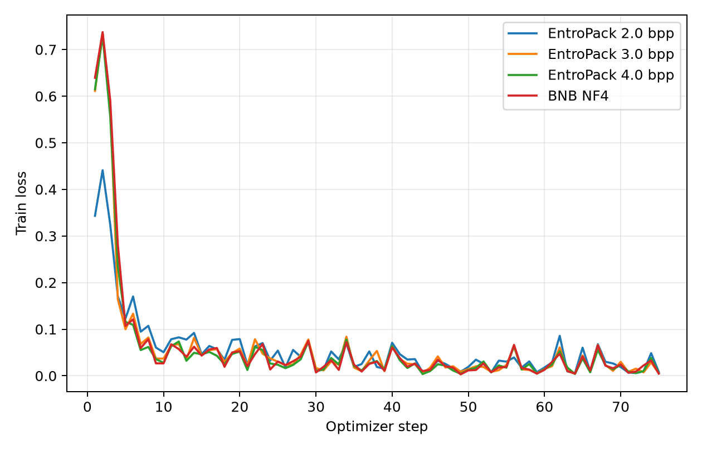
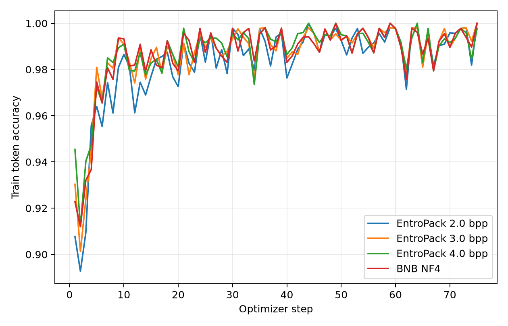
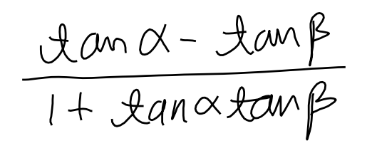
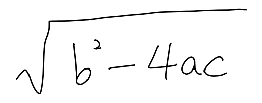

# EntroPack 灵活量化最佳实践

常见的权重量化方案通常提供 4 bit、8 bit 等固定格式。当模型质量或显存预算落在两个档位之间时，只能在固定选项中取舍。EntroPack 直接以 bits per parameter（bpp）作为压缩目标，`target_bpp` 可以设置为 3.5、5.2 等小数，从而更细地控制权重占用。EntroPack 先将权重向量量化到 E8 lattice，再用 rANS 对量化结果进行熵编码。编码器会搜索合适的量化尺度，使最终码率接近指定的 `target_bpp`。整个过程只依赖权重本身，不需要校准数据、激活统计或额外微调，既可以在模型加载时在线完成，也可以导出为可重复加载的压缩 checkpoint。

ms-swift 支持 `default`、`fp8` 和 `int8` 三种 EntroPack 线性层。`default` 在前向时恢复权重并执行普通线性运算；`fp8` 和 `int8` 将低于 8 bpp 的权重存储与对应的低精度计算结合。用户可以分别选择存储码率和计算方式，而不必把二者绑定到同一个固定位宽。FP8 需要 GPU compute capability 8.9 或更高版本，INT8 需要 8.0 或更高版本。

本文以 `Qwen/Qwen3.8-27B` 为例，演示在线推理、权重导出和 LoRA 训练。命令中的 4.0 bpp 只是示例，可以按显存和模型质量要求替换。压缩线性层权重的理论存储量约为：

```text
压缩参数量 × target_bpp ÷ 8
```

`target_bpp` 是码率控制目标，实际占用还会包含编码元数据、未压缩权重、激活值和 KV cache。

## 环境安装

Transformers 的 EntroPack 接入正式发布前，安装以下分支：

```shell
pip install -U ms-swift
pip install "transformers @ git+https://github.com/mi804/transformers.git@entropack-integration"
```

根据 CUDA 版本安装 EntroPack：

```shell
# CUDA 12
pip install "entropack[cuda12]>=0.1.3"

# CUDA 13
pip install "entropack[cuda13]>=0.1.3"
```

## 在线量化推理

在线量化直接从原始 checkpoint 生成 EntroPack 权重，不需要提前准备量化模型。通过 `entropack_target_bpp` 调整存储预算，通过 `entropack_linear_type` 选择计算方式。

```shell
CUDA_VISIBLE_DEVICES=0 \
swift infer \
    --model Qwen/Qwen3.8-27B \
    --quant_method entropack \
    --entropack_target_bpp 4.0 \
    --entropack_linear_type default \
    --infer_backend transformers \
    --stream true \
    --max_new_tokens 512
```

在线量化直接读取原始模型，不产生新的 checkpoint。每次重新启动都会再次量化。

`entropack_linear_type` 可选 `default`、`fp8` 和 `int8`。`default` 支持 `[0.001, 11]` bpp，`fp8` 和 `int8` 要求 target bpp 小于 8。

## 导出量化权重

`swift export` 会将在线量化结果保存为完整模型目录。该目录可以复制到其他机器，也可以作为后续训练和推理的 `--model` 输入。

```shell
CUDA_VISIBLE_DEVICES=0 \
swift export \
    --model Qwen/Qwen3.8-27B \
    --quant_method entropack \
    --entropack_target_bpp 4.0 \
    --entropack_linear_type default \
    --torch_dtype bfloat16 \
    --output_dir Qwen3.8-27B-EntroPack
```

导出后的目录可以直接用于推理：

```shell
CUDA_VISIBLE_DEVICES=0 \
swift infer \
    --model Qwen3.8-27B-EntroPack \
    --infer_backend transformers \
    --stream true \
    --max_new_tokens 512
```

量化参数已经保存在模型配置中，加载导出权重时不需要再次传入 `quant_method` 或 `entropack_target_bpp`。

## LoRA 训练

LoRA 训练可以直接在线量化原始模型，也可以加载已经导出的 EntroPack checkpoint。两种方式训练相同的 adapter；区别在于前者会在启动时执行量化，后者直接读取压缩权重。

### 从原始权重在线量化

下面的命令加载 Qwen3.8-27B 原始权重，在模型加载阶段按 4.0 bpp 量化，然后开始 LoRA 训练：

```shell
CUDA_VISIBLE_DEVICES=0 \
swift sft \
    --model Qwen/Qwen3.8-27B \
    --quant_method entropack \
    --entropack_target_bpp 4.0 \
    --entropack_linear_type default \
    --tuner_type lora \
    --dataset 'AI-ModelScope/alpaca-gpt4-data-zh#500' \
              'AI-ModelScope/alpaca-gpt4-data-en#500' \
              'swift/self-cognition#500' \
    --torch_dtype bfloat16 \
    --num_train_epochs 1 \
    --per_device_train_batch_size 1 \
    --per_device_eval_batch_size 1 \
    --learning_rate 1e-4 \
    --lora_rank 8 \
    --lora_alpha 32 \
    --target_modules all-linear \
    --freeze_vit true \
    --freeze_aligner true \
    --gradient_accumulation_steps 16 \
    --eval_steps 50 \
    --save_steps 50 \
    --save_total_limit 2 \
    --logging_steps 5 \
    --max_length 2048 \
    --output_dir output/Qwen3.8-27B-EntroPack \
    --warmup_ratio 0.05 \
    --dataloader_num_workers 4
```

训练目录中保存 LoRA adapter 和训练状态；原始模型不会被改写。

### 使用导出的量化权重

将 `--model` 指向 `swift export` 的输出目录即可：

```shell
CUDA_VISIBLE_DEVICES=0 \
swift sft \
    --model Qwen3.8-27B-EntroPack \
    --tuner_type lora \
    --dataset 'AI-ModelScope/alpaca-gpt4-data-zh#500' \
              'AI-ModelScope/alpaca-gpt4-data-en#500' \
              'swift/self-cognition#500' \
    --torch_dtype bfloat16 \
    --num_train_epochs 1 \
    --per_device_train_batch_size 1 \
    --per_device_eval_batch_size 1 \
    --learning_rate 1e-4 \
    --lora_rank 8 \
    --lora_alpha 32 \
    --target_modules all-linear \
    --freeze_vit true \
    --freeze_aligner true \
    --gradient_accumulation_steps 16 \
    --eval_steps 50 \
    --save_steps 50 \
    --save_total_limit 2 \
    --logging_steps 5 \
    --max_length 2048 \
    --output_dir output/Qwen3.8-27B-EntroPack \
    --warmup_ratio 0.05 \
    --dataloader_num_workers 4
```

这一路径不会重新量化原始权重，适合直接复用已经生成的 EntroPack 模型。

## 加载 LoRA adapter 推理

LoRA checkpoint 只保存 adapter 参数，不包含 EntroPack 基座。直接传入 adapter 路径时，ms-swift 会读取训练时保存的参数，并使用训练时的基座模型进行推理：

```shell
CUDA_VISIBLE_DEVICES=0 \
swift infer \
    --adapters output/Qwen3.8-27B-EntroPack/vx-xxx/checkpoint-xxx \
    --infer_backend transformers \
    --stream true \
    --max_new_tokens 512
```

EntroPack 训练得到的 LoRA adapter 也可以加载到原始 dense 基模上。此时显式指定原始模型，并设置 `load_args=false`，避免恢复训练时的 EntroPack 参数：

```shell
CUDA_VISIBLE_DEVICES=0 \
swift infer \
    --model Qwen/Qwen3.8-27B \
    --adapters output/Qwen3.8-27B-EntroPack/vx-xxx/checkpoint-xxx \
    --load_args false \
    --infer_backend transformers \
    --stream true \
    --max_new_tokens 512
```

因此 EntroPack 可以只用于降低 LoRA 训练阶段的基座权重占用，部署时仍可根据需要选择原始基模或 EntroPack 基模。由于两种基模的权重不同，正式部署前应分别评估效果。

## 多卡 LoRA

多卡训练同样可以直接使用导出的 EntroPack checkpoint。DDP 下每张卡加载一份压缩基座，并同步 LoRA 梯度：

```shell
CUDA_VISIBLE_DEVICES=0,1 \
NPROC_PER_NODE=2 \
swift sft \
    --model Qwen3.8-27B-EntroPack \
    --tuner_type lora \
    --dataset train.jsonl \
    --torch_dtype bfloat16 \
    --per_device_train_batch_size 1 \
    --learning_rate 1e-4 \
    --lora_rank 8 \
    --lora_alpha 32 \
    --target_modules all-linear \
    --output_dir output/Qwen3.8-27B-EntroPack-DDP
```

使用 FSDP2 时，通过 `--fsdp fsdp2` 启用参数分片：

```shell
CUDA_VISIBLE_DEVICES=0,1 \
NPROC_PER_NODE=2 \
swift sft \
    --model Qwen3.8-27B-EntroPack \
    --tuner_type lora \
    --dataset train.jsonl \
    --torch_dtype bfloat16 \
    --per_device_train_batch_size 1 \
    --learning_rate 1e-4 \
    --lora_rank 8 \
    --lora_alpha 32 \
    --target_modules all-linear \
    --fsdp fsdp2 \
    --output_dir output/Qwen3.8-27B-EntroPack-FSDP2
```

EntroPack 当前不支持 DeepSpeed ZeRO。FSDP2 需要 PyTorch 2.7 或更高版本。

## 实际训练效果对比

### 训练设置

我们使用 Qwen3.8-27B 在 `AI-ModelScope/LaTeX_OCR:human_handwrite` 上进行 LoRA 对比。训练集 1200 条，验证集 50 条；使用两张 NVIDIA H20，单卡 batch size 为 8，全局 batch size 为 16，训练 1 个 epoch（75 optimizer steps）。LoRA rank 为 8，alpha 为 32，学习率为 1e-4。除量化配置外，其余参数完全相同。

对比以下配置：

- EntroPack 2.0 bpp；
- EntroPack 3.0 bpp；
- EntroPack 4.0 bpp；
- BitsAndBytes NF4 4-bit，BF16 compute，double quant。

### 结果对比

#### Loss 与精度曲线

<p align="center">
  
  
</p>

四组都能稳定收敛，validation token accuracy 均高于 99.5%。

#### 指标对比

权重重建误差在全部 606 个量化线性层、24.806B 权重上计算。量化模型大小为 `state_dict` 中全部 tensor 的总字节数。

| 配置 | 权重相对误差 | 量化模型大小 | 稳定每 step 时间 | 单卡显存峰值 |
|---|---:|---:|---:|---:|
| EntroPack 2.0 bpp | 28.69% | **10.57 GiB** | 3.125 s | **19.43 GiB** |
| EntroPack 3.0 bpp | 14.37% | 13.49 GiB | 3.125 s | 22.26 GiB |
| EntroPack 4.0 bpp | **7.19%** | 16.40 GiB | 3.156 s | 25.43 GiB |
| BNB NF4 | 9.29% | 16.67 GiB | **3.063 s** | 25.26 GiB |

EntroPack 4.0 bpp 与 BNB NF4 模型大小接近，但权重重建误差更低。降低 target bpp 可以连续减少模型大小和训练显存；2.0 bpp 相比 BNB NF4 少约 5.8 GiB/卡，但重建误差也明显增大。

#### LoRA 推理结果

训练结束后，四组 adapter 在相同的两条 OCR 样例上使用 `temperature=0` 推理。四组都输出了正确公式。

| 图片 | Ground truth | EntroPack 2.0 bpp | EntroPack 3.0 bpp | EntroPack 4.0 bpp | BNB NF4 |
|---|---|---|---|---|---|
|  | `\frac { \tan \alpha - \tan \beta } { 1 + \tan \alpha \tan \beta }` | 正确 | 正确 | 正确 | 正确 |
|  | `\sqrt { b ^ { 2 } - 4 a c }` | 正确 | 正确 | 正确 | 正确 |

## 使用限制

当前 EntroPack 的 ms-swift 接入仅支持 CUDA 生态设备。

EntroPack 的权重采用熵编码存储，线性层计算前需要先完成熵信息解码。对于 QLoRA 训练和 LLM prefill，这部分开销可以被较大的矩阵计算摊薄。逐 token 自回归解码时，每一步处理的 token 较少，熵解码开销占比会升高，因此生成速度可能低于未压缩权重或固定宽度量化方案。对生成延迟敏感的场景，应在目标模型、batch size 和上下文长度下实际测试解码速度。

完整参数说明参考[命令行参数文档](../Instruction/Command-line-parameters.md#量化参数)。
